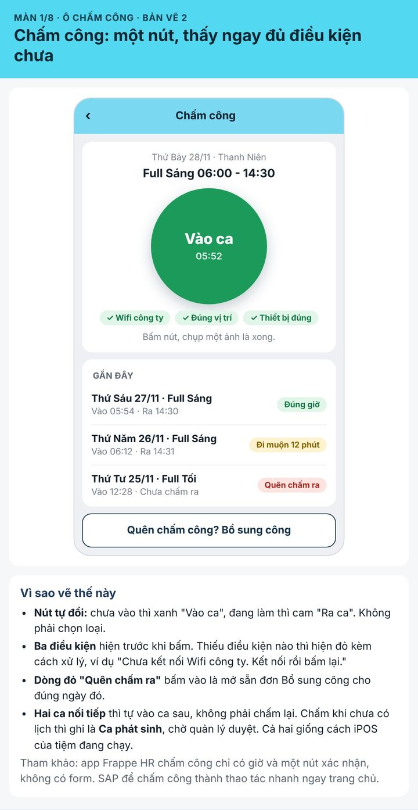
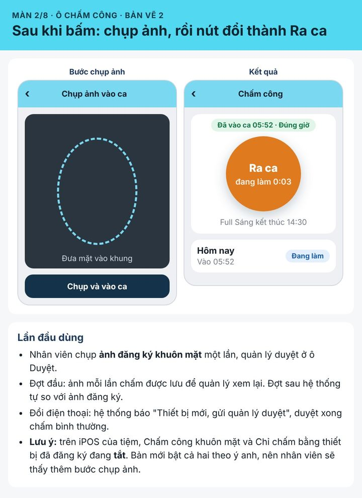
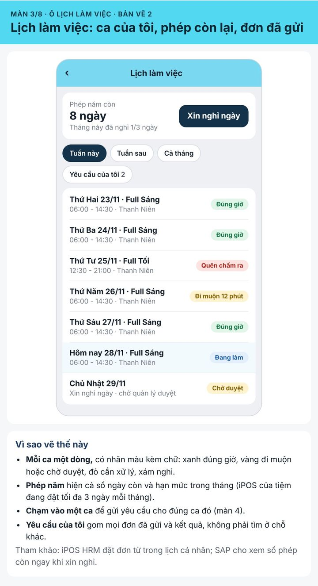
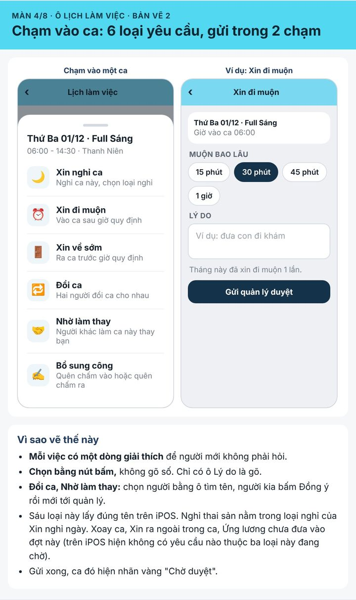
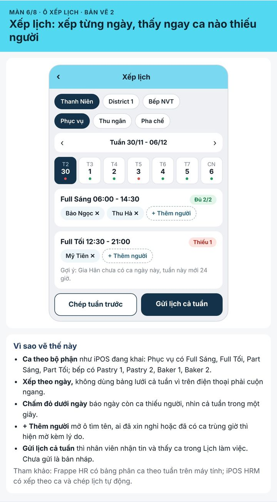
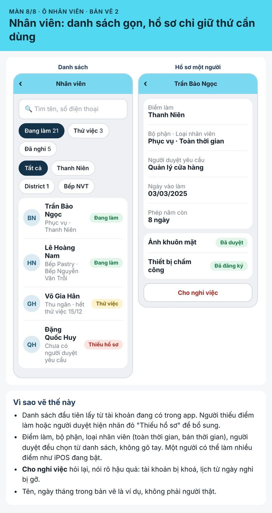

# Đề xuất chuyển Nhân sự từ iPOS HRM sang app Vagabond

Bản 28/11/2026, cập nhật trưa 28/11 theo trả lời của anh Việt. Chưa có code. Đi chung PR với đề xuất hoa hồng (`docs/de-xuat-chinh-sach-hoa-hong-11-2026.md`) vì giờ công và hồ sơ nhân viên ở đây là đầu vào của phiếu KPI.

Repo công khai: tên người trong ảnh vẽ là tên giả, giờ giấc là ví dụ. Không ghi tên wifi, mã thiết bị, lương của ai.

## 1. Tóm tắt cho anh Việt

- **Vấn đề:** chấm công, xếp lịch, đơn từ đang nằm ở iPOS HRM, tách khỏi ERP, chia hai app (nhân viên và quản lý), hơn 45 ô chức năng. Giờ công cho thưởng phải nạp tay.
- **Việc sẽ làm:** dùng Frappe HR làm phần máy phía sau (hồ sơ, ca, lượt chấm, bảng công, phép). Màn bấm hằng ngày đặt trong mục **Nhân sự** của app Vagabond: **một app, thêm 6 ô**. Tài khoản quản lý tự thấy thêm ô duyệt, không cần app thứ hai.
- **Kết quả sẽ thấy:** nhân viên chấm công bằng một nút; quản lý duyệt mọi loại yêu cầu ở một chỗ; kế toán khoá bảng công tháng và xuất gửi bên làm lương; phiếu KPI tự lấy giờ công.
- **Anh đã chốt (27 và 28/11):** dùng Frappe HR thay iPOS HRM; màn nhân viên làm trong app Vagabond; tối giản, một app cho cả nhân viên và quản lý; lương giai đoạn đầu vẫn để bên làm lương tính, ERP chỉ xuất bảng công; chấm công kiểm wifi công ty cộng định vị; khuôn mặt làm trước bước lưu ảnh, tự so ảnh làm sau; danh sách nhân viên lấy trước từ danh sách tài khoản; 6 ô theo phương án A; câu chữ theo bản vẽ 2.
- **Anh chốt thêm 28/11:** giữ y ba cách tính của iPOS ở mục 4; Xin đi muộn, Xin về sớm tối đa 3 lần mỗi tháng và tự sửa được trong Cài đặt; đường mạng các điểm có địa chỉ cố định; mẫu văn bản đồng ý dùng ảnh khuôn mặt do Claude soạn (`mau-dong-y-du-lieu-cham-cong.md`); danh sách nhân viên lấy từ iPOS HRM.
- **Còn chờ anh:** xem mục 7.

## 2. Sáu ô mới trong mục Nhân sự

| Ô | Ai thấy | Việc |
|---|---|---|
| Chấm công | Mọi người | Vào ca, ra ca bằng một nút. Cũng là nút lớn ở Trang chủ |
| Lịch làm việc | Mọi người | Ca của tôi, phép còn, gửi yêu cầu theo từng ca |
| Duyệt | Quản lý trở lên | Mọi yêu cầu chờ duyệt ở một danh sách |
| Xếp lịch | Quản lý trở lên | Xếp ca theo tuần cho điểm mình quản |
| Bảng chấm công | Quản lý xem điểm mình; Kế toán khoá kỳ và xuất | Theo dõi trong ngày, tổng hợp công tháng |
| Nhân viên | Kế toán, giám đốc | Hồ sơ, điểm làm, bộ phận, người duyệt yêu cầu |

Năm ô đang có (Tuyển dụng, Duyệt KPI và hoa hồng, Bảng chỉ tiêu và bậc hoa hồng, Điểm KPI của tôi, Hoa hồng giới thiệu) giữ nguyên.

## 3. Màn bên trong (bản vẽ 2)

| Ảnh | Màn |
|---|---|
|  | **Chấm công.** Nút tự đổi Vào ca / Ra ca. Ba điều kiện hiện trước khi bấm: Wifi công ty, Đúng vị trí, Thiết bị đúng. Thiếu điều kiện nào thì hiện đỏ kèm cách xử lý. Dòng "Quên chấm ra" bấm vào mở sẵn Bổ sung công |
|  | **Chụp ảnh khi chấm.** Lần đầu chụp ảnh đăng ký, quản lý duyệt. Đổi điện thoại thì gửi quản lý duyệt thiết bị mới |
|  | **Lịch làm việc.** Phép năm còn và hạn mức tháng ở đầu màn. Mỗi ca một dòng có nhãn màu kèm chữ. Lọc Tuần này, Tuần sau, Cả tháng, Yêu cầu của tôi |
|  | **Chạm vào ca:** 6 loại yêu cầu (Xin nghỉ ca, Xin đi muộn, Xin về sớm, Đổi ca, Nhờ làm thay, Bổ sung công), chọn bằng nút bấm, chỉ gõ lý do |
|  | **Duyệt.** Ba hàng lọc (trạng thái có đếm, loại yêu cầu, khoảng ngày). Thẻ đủ thông tin để quyết: phép còn, hạn mức, lý do, cảnh báo ca thiếu người. Từ chối bắt ghi lý do |
|  | **Xếp lịch.** Chọn điểm làm và bộ phận, xếp theo từng ngày, chấm đỏ báo ngày còn ca thiếu người. Chép tuần trước, Gửi lịch cả tuần |
|  | **Bảng chấm công.** Hôm nay, Tuần, Tháng. Người cần chú ý đứng đầu. Kế toán khoá kỳ, xuất gửi bên làm lương |
|  | **Nhân viên.** Danh sách có ô tìm, lọc trạng thái và điểm làm. Hồ sơ chỉ giữ thứ cần dùng. Cho nghỉ việc hỏi lại kèm hậu quả |

## 4. Giữ theo cách iPOS HRM của tiệm đang chạy

Đọc trực tiếp trên iPOS HRM ngày 28/11/2026, chỉ xem, không sửa.

- **Tên gọi:** Đi muộn, Về sớm, Quên chấm vào, Quên chấm ra, Nghỉ phép, Nghỉ không phép, Ca phát sinh, Trùng thiết bị. Tên sáu loại yêu cầu giữ như iPOS.
- **Ca gắn theo bộ phận:** Phục vụ có Full Sáng 06:00 - 14:30, Full Tối 12:30 - 21:00, Part Sáng, Part Tối; bếp có Pastry 1, Pastry 2, Baker 1, Baker 2. Khai lại y như vậy.
- **Loại ngày nghỉ:** 8 loại đang dùng (phép năm theo nhóm, nghỉ không lương, nghỉ lễ). Mỗi loại có tổng ngày và hạn mức tháng; khai lại y như vậy.
- **Cách tính đang bật, giữ nguyên (anh chốt 28/11):**
  - làm nhiều chi nhánh;
  - hai ca nối tiếp thì tự vào ca sau;
  - chấm khi chưa có lịch thì thành Ca phát sinh, chờ duyệt;
  - giờ quản lý sửa được dùng để tính công;
  - báo quản lý khi nhân viên vào ca, ra ca.
- **Khác iPOS, theo ý anh:** iPOS đang tắt "Chấm công khuôn mặt" và "Chỉ được phép chấm công bằng thiết bị đã đăng ký". Bản mới bật cả hai.
- **Chưa đưa vào đợt này:** Xoay ca, Xin ra ngoài trong ca, Ứng lương, Lương, Hợp đồng, Giao việc, Truyền thông nội bộ.
- **Điểm làm:** trên iPOS chỉ Thanh Niên đang hoạt động; District 1 và bếp Nguyễn Văn Trỗi đang ngưng. Hai điểm này sẽ chấm công lần đầu, không có số iPOS để so lúc chạy song song.

## 5. Kỹ thuật

- **Wifi công ty:** app chạy trên trình duyệt nên không đọc được tên wifi như app iPOS. Máy chủ kiểm lượt chấm có đi ra từ địa chỉ mạng cố định của điểm làm hay không (anh xác nhận các điểm có địa chỉ cố định, 28/11). Định vị trong bán kính điểm làm là lớp dự phòng. Địa chỉ mạng khai trong Cài đặt nhân sự, ở mục Điểm làm; không ghi vào repo.
- **Thiết bị đúng:** ghi nhớ điện thoại lần đầu; đổi máy thì quản lý duyệt.
- **Khuôn mặt:** đợt đầu lưu ảnh kèm lượt chấm để quản lý xem lại; đợt sau mới tự so ảnh, sau khi thử độ chính xác trên điện thoại thật. Ảnh khuôn mặt là dữ liệu cá nhân nhạy cảm: cần văn bản nhân viên đồng ý, ảnh không để ở chỗ công khai.
- **Frappe HR:** site đang chạy Frappe 16 và ERPNext 16, chưa cài Frappe HR, chưa có hồ sơ nhân viên. Cài thử trên bản thử trước, không đụng site thật cho tới khi anh cho phép.
- **Hồ sơ đầu tiên:** lấy từ danh sách nhân viên đang làm trên iPOS HRM (61 người, đọc ngày 28/11): mã nhân viên, tên, bộ phận, điểm làm, loại nhân viên, ngày vào; ghép với tài khoản đang có trong app. Ai chưa có tài khoản, hoặc thiếu điểm làm, người duyệt, thì hiện nhãn "Thiếu hồ sơ". Danh sách có tên thật nên chỉ nạp thẳng vào site, không lưu trong repo.
- **Cài đặt nhân sự** (chỉ giám đốc và kế toán): hạn mức Xin đi muộn, Xin về sớm mỗi tháng (mặc định 3, sửa được; đặt 0 nghĩa là không cho xin, khác với để trống); điểm làm kèm địa chỉ mạng và bán kính định vị; ca; loại nghỉ.
- **Nối với hoa hồng:** giờ công trong bảng chấm công là nguồn cho F11 (chia quỹ theo giờ công) và F7 (thưởng hiệu quả theo ngày công) của đề xuất hoa hồng, thay cho bảng nạp tay.

## 6. Lộ trình

| Đợt | Việc | Kết quả anh thấy |
|---|---|---|
| 1. Nền | Cài Frappe HR (cần anh cho phép deploy). Hồ sơ nhân viên, điểm làm, ca, loại nghỉ | Ô Nhân viên có danh sách người |
| 2. Lịch và chấm công | Xếp lịch, Chấm công (wifi, định vị, thiết bị, ảnh) | Chạy thử ở Thanh Niên, song song iPOS |
| 3. Yêu cầu và Duyệt | Sáu loại yêu cầu, ô Duyệt, báo Zalo nhóm bộ phận | Bỏ được đơn từ trên iPOS |
| 4. Bảng chấm công | Bảng công tháng, khoá kỳ, xuất cho bên làm lương; nối giờ công vào phiếu KPI | So bảng công ERP với iPOS cùng một kỳ |
| 5. Tắt iPOS HRM | Chỉ khi một kỳ lương chạy song song khớp | Một hệ thống |

Nguyên tắc: không chép lượt chấm cũ từ iPOS sang; chỉ nhập số ngày phép còn tại ngày chuyển. Mỗi đợt một PR, Codex rà, anh duyệt mới lên site.

## 7. Câu hỏi

**Cho anh Việt**
Đã chốt 28/11: giữ y ba cách tính của iPOS; hạn mức 3 lần mỗi tháng, sửa trong Cài đặt; địa chỉ mạng cố định; Claude soạn mẫu đồng ý.

1. Đọc và duyệt mẫu `mau-dong-y-du-lieu-cham-cong.md`. Đây là bản Claude soạn, không phải ý kiến luật sư; anh nên nhờ người có chuyên môn pháp lý xem lại trước khi cho nhân viên ký.
2. Người không đồng ý chụp ảnh: em đề xuất cho chấm công không ảnh, quản lý xác nhận lượt chấm (mẫu mục 5). Anh đồng ý cách này?

**Cho Codex**
- Rà luồng: có chỗ nào một yêu cầu bị duyệt hai lần, hoặc ca bị xếp trùng người, khi hai quản lý cùng thao tác?
- Rà quyền: quản lý chỉ thấy điểm mình; kế toán, giám đốc thấy mọi điểm; nhân viên chỉ thấy của mình.
- Rà chuyển đổi: chạy song song iPOS một kỳ lương có đủ để phát hiện lệch công không?
